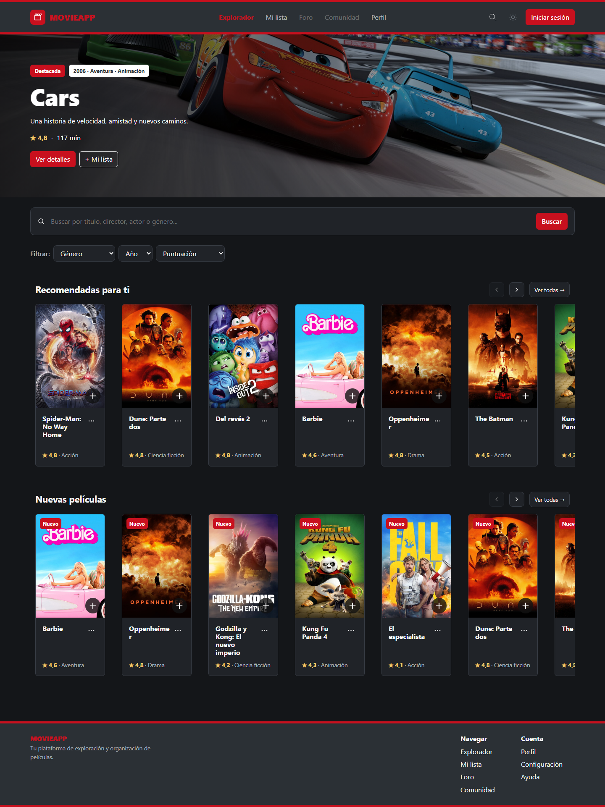
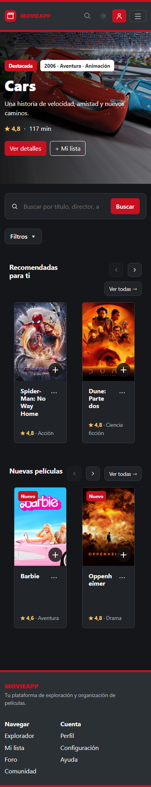
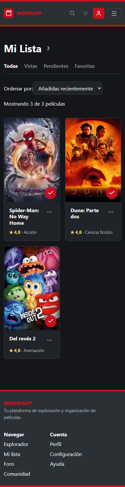
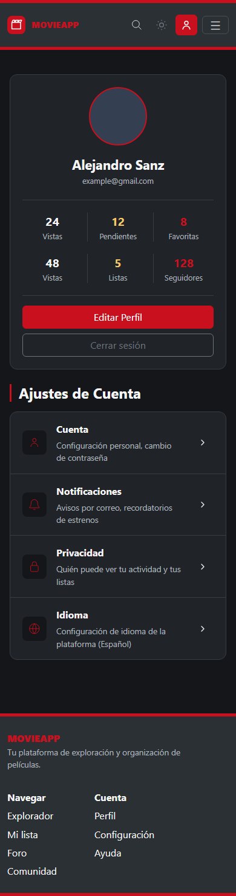
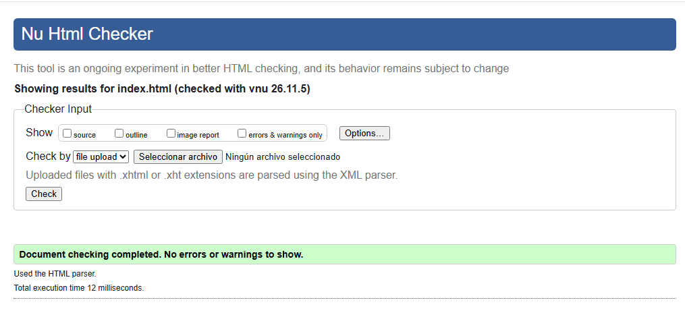
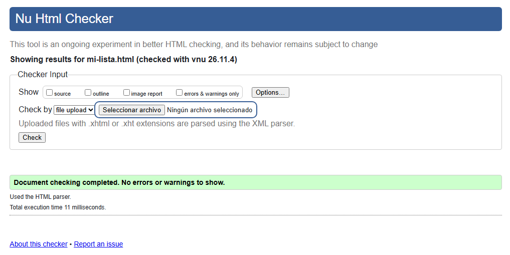

# MovieApp


## Estructura del proyecto

```text
PaginaFigma/
├── index.html                 # Página principal: explorador de películas
├── mi-lista.html              # Vista de ejemplo de películas guardadas
├── perfil.html                # Vista de perfil y ajustes
├── css/
│   └── custom.css             # CSS compilado que cargan las páginas
├── scss/
│   ├── custom.scss            # Punto de entrada: importa Bootstrap y MovieApp
│   ├── bootstrap.scss         # Entrada de los estilos fuente de Bootstrap
│   ├── movieapp/              # Estilos propios organizados por responsabilidad
│   │   ├── _variables.scss    # Colores, fuente y variables de Bootstrap
│   │   ├── _mixins.scss       # Mixin para puntos de ruptura
│   │   ├── _theme.scss        # Colores para los temas y personalización
│   │   ├── _typography.scss   # Tipografía
│   │   ├── _layout.scss       # Cabecera, navegación y estructura
│   │   ├── _explorer.scss     # Explorador y película destacada
│   │   ├── _components.scss   # Tarjetas, carruseles y otros componentes
│   │   ├── _pages.scss        # Estilos de Mi lista y Perfil
│   │   └── _responsive.scss   # Adaptación a distintos tamaños de pantalla
│   └── ...                    # Resto de archivos fuente de Bootstrap
├── js/
│   ├── bootstrap.bundle.min.js # Componentes Bootstrap y Popper
│   ├── script.js              # Tema, formularios y controles generales
│   ├── movies.js              # Carruseles y acciones visuales de películas
│   └── ...                    # Resto de archivos de Bootstrap
├── imagenes/                  # Portada y carteles de las películas
├── docs/
│   ├── CAPTURAS.md            # Galería adicional de las vistas
│   └── capturas/              # Capturas de la aplicación y validaciones
└── .vscode/settings.json      # Configuración de Live Sass Compiler
```

Los archivos HTML definen el contenido y la estructura de cada vista. El código propio de Sass se encuentra en `scss/movieapp/`; `scss/custom.scss` lo combina con Bootstrap y se compila a `css/custom.css`, que es el archivo enlazado desde las páginas. JavaScript añade las interacciones del navegador.

## Uso y funcionalidades

Abre `index.html` en un navegador para entrar en el explorador. Desde la navegación se puede acceder a Mi lista y Perfil.

- El menú de navegación se adapta a móvil y utiliza el componente de Bootstrap.
- El botón de tema alterna entre claro y oscuro y guarda la preferencia en el navegador.
- El formulario de inicio de sesión valida el correo y una contraseña de al menos ocho caracteres. Al introducir datos válidos y pulsar **Continuar**, se cierra el modal.
- Los carruseles y las acciones visuales de las tarjetas utilizan `js/movies.js`. El buscador y los filtros son visuales; el marcado de tarjetas no se guarda ni se sincroniza entre páginas. Los ajustes de Perfil y sus metricas al igual que Mi lista, usan datos mock

## Compilación de Sass


He usado Live Sass Compiler en VS Code. La configuración de `.vscode/settings.json` apunta a `scss/custom.scss`, genera `css/custom.css`.

## Capturas de la aplicación

Las capturas muestran las páginas completas en modo oscuro, con ventanas de **1440 × 900 px** para el ordenador y **390 × 844 px** para movil.

### Explorador

**Ordenador**



**Móvil** 



### Mi lista

**Ordenador**


**Móvil**



### Perfil

**Ordenador**


**Móvil**



## Validación W3C

El 6 de noviembre de 2026 se comprobaron los archivos actuales con el [validador HTML Nu](https://validator.w3.org/nu/) y el [validador CSS del W3C](https://jigsaw.w3.org/css-validator/):

| Archivo | Resultado |
| --- | --- |
| `index.html` | 0 errores y 0 advertencias |
| `mi-lista.html` | 0 errores y 0 advertencias |
| `perfil.html` | 0 errores y 0 advertencias |
| `css/custom.css` | Válido, 0 errores y 204 advertencias |

Las advertencias CSS incluyen extensiones de navegador y avisos sobre variables CSS; muchas proceden del código de Bootstrap integrado en el archivo compilado. Según la revisión de los mensajes, no parece que haya alguna advertencia que parezca crítica para el funcionamiento de la página. Por tanto, se cumple los 0 errores y 0 advertencias críticas.

### HTML: Explorador



### HTML: Mi lista



### HTML: Perfil


### CSS compilado


