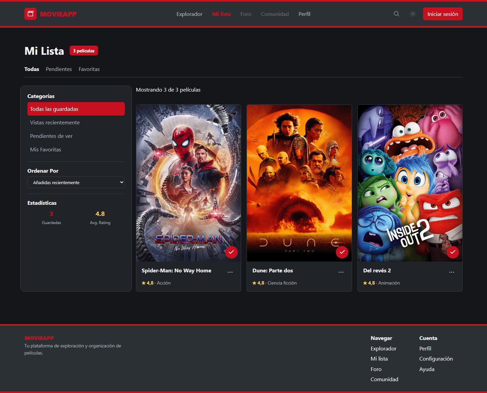
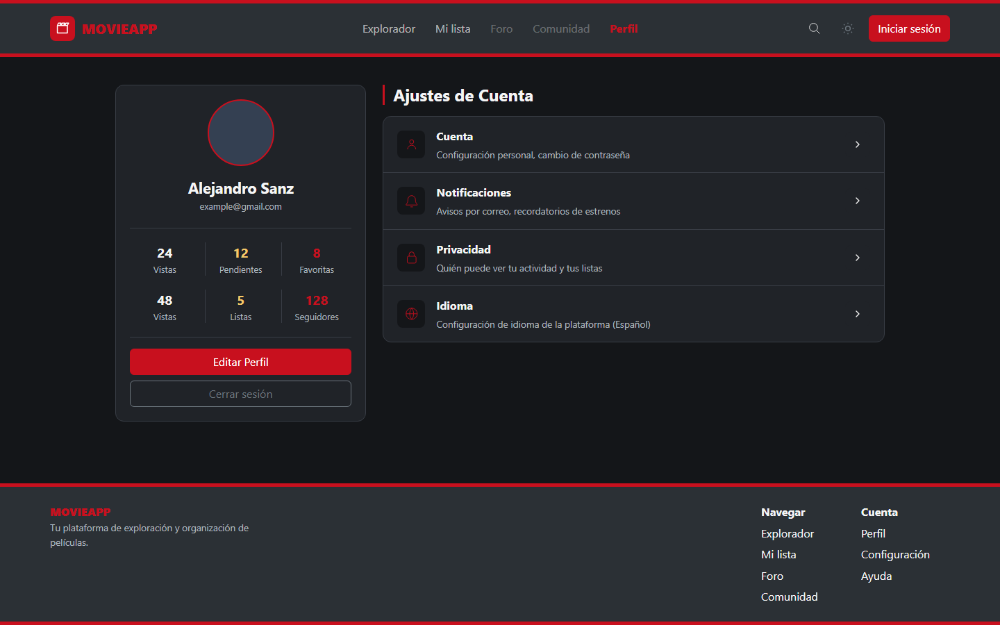
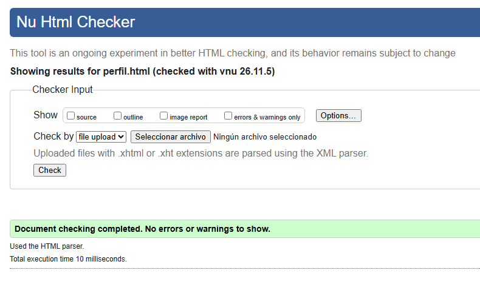
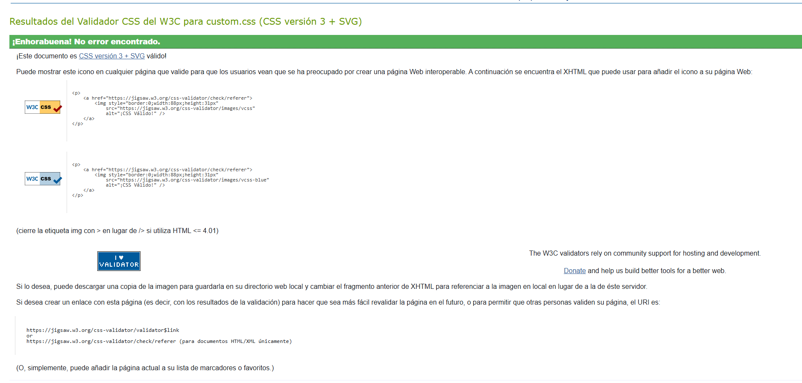

# MovieApp


## Estructura del proyecto

```text
PaginaFigma/
├── src/                       # Sitio web listo para publicar
│   ├── index.html             # Página principal: explorador de películas
│   ├── mi-lista.html          # Vista de ejemplo de películas guardadas
│   ├── perfil.html            # Vista de perfil y ajustes
│   ├── css/custom.css         # CSS compilado que cargan las páginas
│   ├── scss/                  # Sass propio (movieapp/) y fuentes de Bootstrap
│   ├── js/                    # script.js, movies.js y Bootstrap
│   └── media/                 # Recursos optimizados para la web
│       ├── img/               # 10 WebP (< 150 KB) y logo-movieapp.svg
│       ├── audio/             # entrada.mp3 (128 kbps)
│       └── video/             # motos-carrera-720p.mp4
├── media-bruto/               # Originales pesados sin procesar
│   ├── img/                   # 10 JPG originales
│   ├── audio/                 # entrada-original.mp3
│   └── video/                 # motos-carrera-1080p.mp4
├── LICENCIAS.md               # Origen, autor y licencia de cada recurso
├── docs/
│   ├── CAPTURAS.md            # Galería adicional de las vistas
│   └── capturas/              # Capturas de la aplicación y validaciones
└── .vscode/settings.json      # Configuración de Live Sass Compiler
```

Los archivos HTML definen el contenido y la estructura de cada vista. El código propio de Sass se encuentra en `scss/movieapp/`; `scss/custom.scss` lo combina con Bootstrap y se compila a `css/custom.css`, que es el archivo enlazado desde las páginas. JavaScript añade las interacciones del navegador.

## Uso y funcionalidades

Abre `src/index.html` en un navegador para entrar en el explorador. Desde la navegación se puede acceder a Mi lista y Perfil.

- El menú de navegación se adapta a móvil y utiliza el componente de Bootstrap.
- El botón de tema alterna entre claro y oscuro y guarda la preferencia en el navegador.
- El formulario de inicio de sesión valida el correo y una contraseña de al menos ocho caracteres. Al introducir datos válidos y pulsar **Continuar**, se cierra el modal.
- Los carruseles y las acciones visuales de las tarjetas utilizan `js/movies.js`. El buscador y los filtros son visuales; el marcado de tarjetas no se guarda ni se sincroniza entre páginas. Los ajustes de Perfil y sus metricas al igual que Mi lista, usan datos mock

## Recursos multimedia

- **Imágenes:** los JPG originales (1696 × 2528 px, unos 3 MB) están en `media-bruto/img/`. Se reescalaron a 800 px de ancho (1600 px la portada) y se exportaron a WebP con menos de 150 KB cada una.
- **Vídeo:** el original de 1080p (13,5 MB) se reescaló a 720p con HandBrake (5,3 MB). Se usa en la portada del explorador, en silencio, con el WebP de portada como póster; se desactiva con `prefers-reduced-motion`.
- **Audio:** el original (256 kbps, 7 s) se recortó en Audacity a unos 3,5 s y se exportó a MP3 de 128 kbps. Suena al iniciar sesión.
- **Logotipo:** `src/media/img/logo-movieapp.svg`, usado también como favicon.
- Origen y licencias de cada recurso: [LICENCIAS.md](LICENCIAS.md).

## Compilación de Sass


He usado Live Sass Compiler en VS Code. La configuración de `.vscode/settings.json` apunta a `scss/custom.scss`, genera `css/custom.css`.

## Capturas de la aplicación

Las capturas muestran las páginas completas en modo oscuro, con ventanas de **1440 × 900 px** para el ordenador y **390 × 844 px** para movil.

### Explorador

**Ordenador**


**Móvil** 


### Mi lista

**Ordenador**



**Móvil**


### Perfil

**Ordenador**



**Móvil**


## Validación W3C

El 6 de noviembre de 2026 se comprobaron los archivos actuales con el [validador HTML Nu](https://validator.w3.org/nu/) y el [validador CSS del W3C](https://jigsaw.w3.org/css-validator/):

| Archivo | Resultado |
| --- | --- |
| `index.html` | 0 errores y 0 advertencias |
| `mi-lista.html` | 0 errores y 0 advertencias |
| `perfil.html` | 0 errores y 0 advertencias |
| `css/custom.css` | Válido, 0 errores y 204 advertencias |

Las advertencias CSS incluyen extensiones de navegador y avisos sobre variables CSS; muchas proceden del código de Bootstrap integrado en el archivo compilado. Según la revisión de los mensajes, no parece que haya alguna advertencia que parezca crítica para el funcionamiento de la página. Por tanto, se cumple los 0 errores y 0 advertencias críticas.

### HTML: Explorador


### HTML: Mi lista


### HTML: Perfil



### CSS compilado


