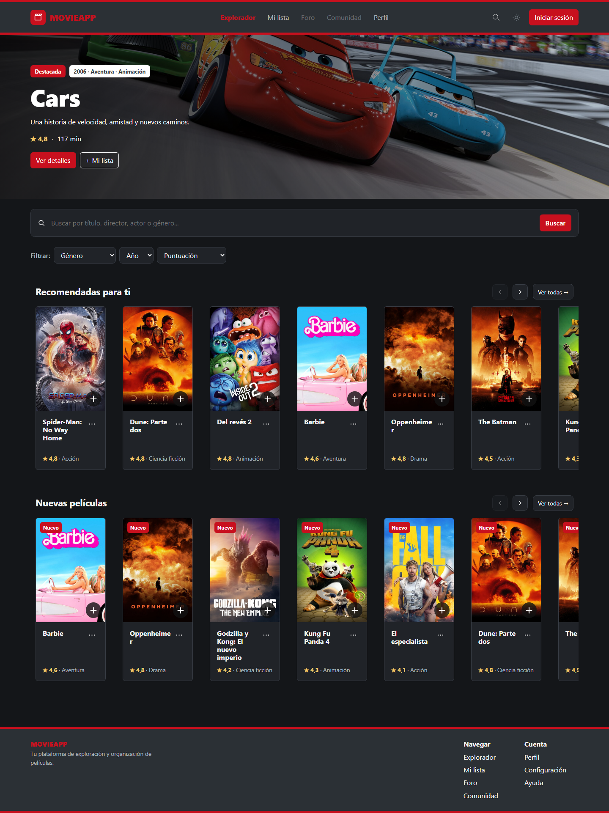
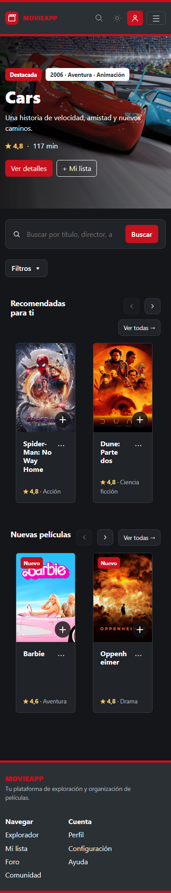
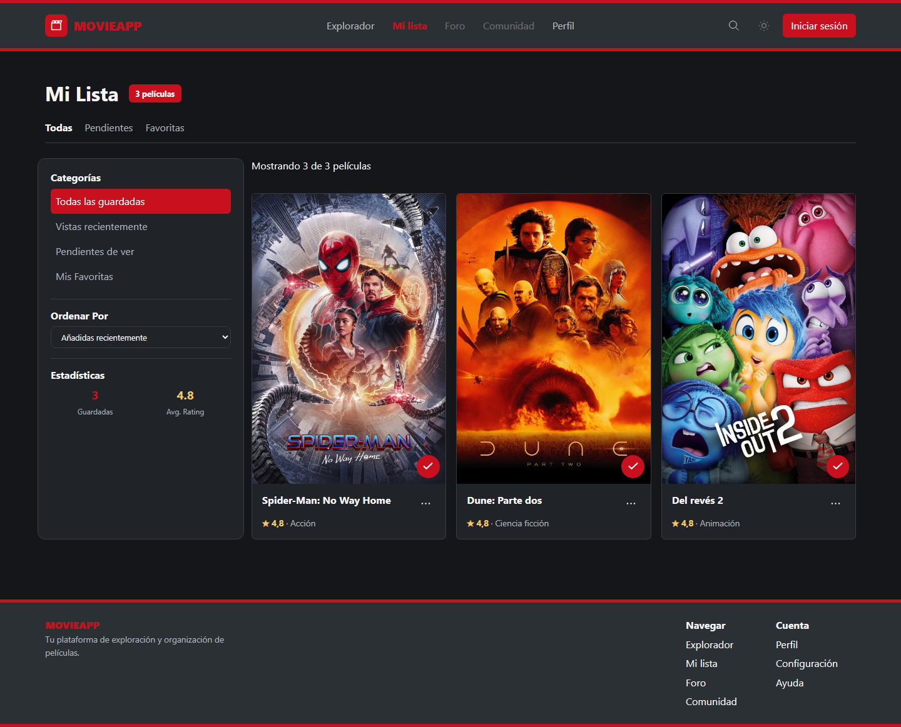
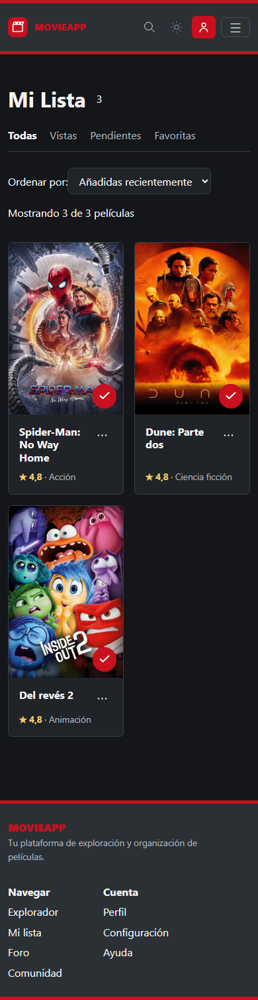
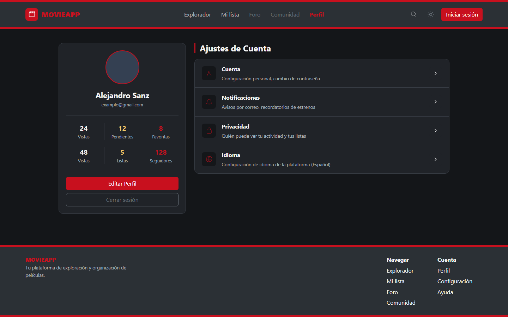
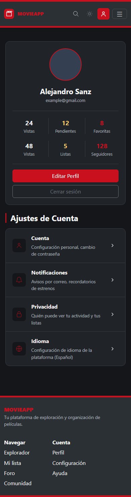

# Capturas de MovieApp

Capturas de las tres vistas de la aplicación, realizadas con Microsoft Edge en modo oscuro. Las imágenes muestran la página completa con una ventana de 1440 × 900 píxeles para ordenador y de 390 × 844 píxeles para móvil.

## Explorador

### Ordenador

### Móvil

## Mi lista

### Ordenador

### Móvil

## Perfil

### Ordenador

### Móvil

